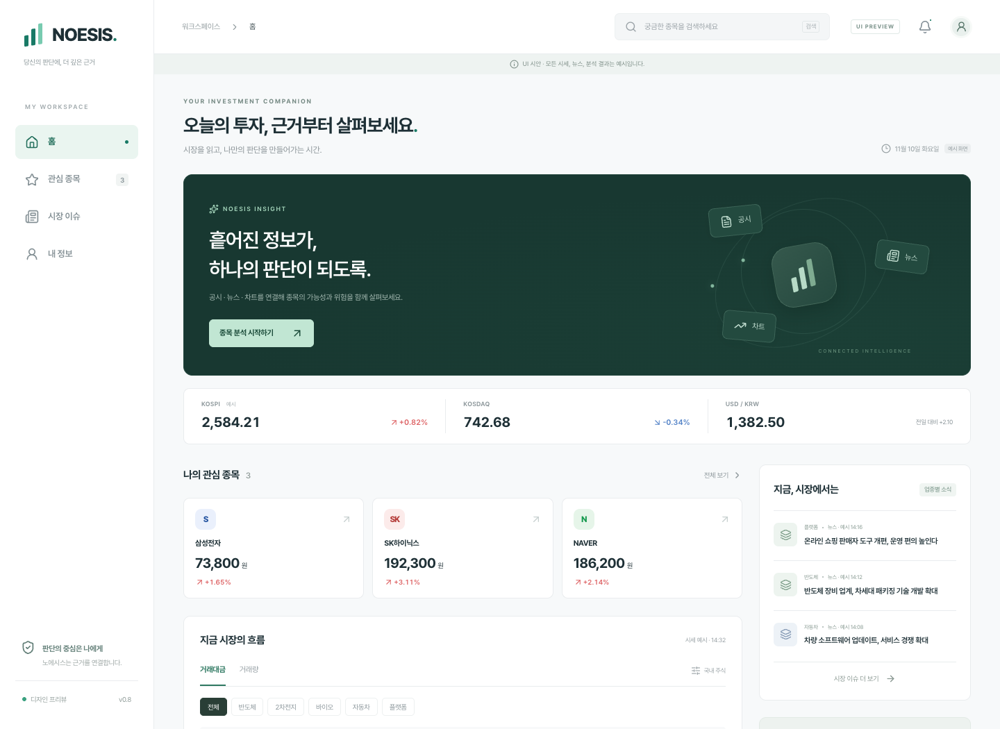
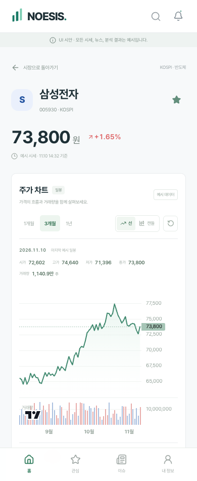
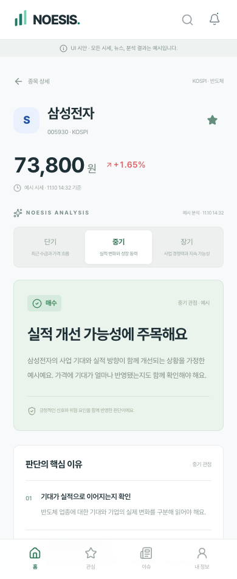
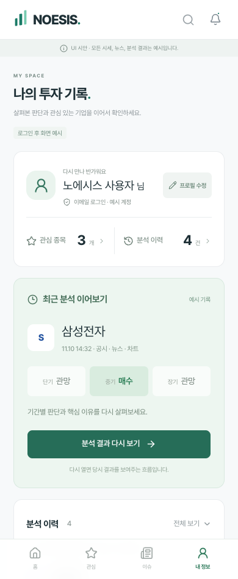

<div align="center">

# Noesis · 노에시스

**이해에서 판단으로.**

공시·뉴스·차트를 함께 읽고, 투자 기간에 따른 판단과 이유를 살펴보는 주식 분석 서비스입니다.


[화면 미리보기](#화면-미리보기) · [로컬 실행](#로컬-실행) · [제품 요구사항](docs/PRODUCT.md) · [구조와 설계](docs/ARCHITECTURE.md)

</div>

> **현재는 예시 데이터로 동작하는 UI 프로토타입입니다.** 실제 AI 분석·실시간 시세·회원 인증·DB·계좌 연동은 아직 연결하지 않았습니다. 화면의 가격·뉴스·공시·매수/관망 판단은 실제 투자 정보가 아닙니다.

## 왜 만들었나요?

종목을 검토할 때 공시, 뉴스, 가격 흐름을 여러 서비스에서 따로 확인해야 합니다. Noesis는 이 정보를 한 흐름으로 연결하고, **단기·중기·장기 판단이 왜 다른지** 살펴볼 수 있는 서비스를 목표로 합니다.

- 투자 경험이 적은 사용자는 판단에 필요한 정보와 핵심 이유를 확인합니다.
- 경험이 있는 사용자는 관심 종목의 자료를 모아 보는 시간과 노력을 줄입니다.
- 핵심 기능은 **종목 분석 → 기간별 판단 → 핵심 이유 → 분석 상세**입니다. 뉴스와 공시는 탐색을 돕는 부가 기능입니다.

이름은 그리스어 *νόησις*에서 가져왔으며, 사고와 지적 이해라는 의미를 담았습니다. [어원 참고](https://logeion.uchicago.edu/morpho/νοήσει)

## 화면 미리보기

아래 화면은 이 저장소의 코드를 로컬에서 실행해 촬영한 예시입니다.



<table>
  <tr>
    <th>종목과 차트</th>
    <th>기간별 분석 결과</th>
    <th>내 정보와 분석 이력</th>
  </tr>
  <tr>
    <td></td>
    <td></td>
    <td></td>
  </tr>
</table>

## 지금 직접 사용해 볼 수 있는 기능

| 영역 | 구현된 동작 | 데이터·연동 상태 |
| --- | --- | --- |
| 홈·검색 | 거래대금/거래량 정렬, 업종 필터, 종목명·코드 검색 | 예시 8종목 |
| 관심 종목 | 추가·해제, 홈/목록/내 정보에 반영 | 이 브라우저의 `localStorage`에 저장 |
| 종목 차트 | 선/캔들 전환, 거래량, 1·3개월/1년 범위, 시점별 OHLCV, 확대·축소 | 결정론적으로 생성한 합성 일봉. 분봉·틱·실시간 연결 전 |
| 분석 결과 | 분석 진행 시연, 단기·중기·장기 판단, 핵심 이유, 공시/뉴스/차트 설명 펼치기 | 미리 준비한 예시 결과. 모델 호출 없음 |
| 뉴스 | 주요 뉴스 배너 6초 순환, 재생/정지, 카테고리별 일반 뉴스, 상세/관련 종목 이동 | 배너와 일반 목록이 겹치지 않는 예시 기사 |
| 공시 | 공시 탭, 주요 일정, 중요/전체·유형·관심 종목 필터, 정정/철회/시간 미정 표시 | 가상 일정·공시. DART/KIND 연결 전 |
| 로그인·회원가입 | 이메일·카카오·Google·네이버 흐름, 비밀번호 찾기·이메일 인증 안내 | 화면 시연만 제공. 계정 생성·메일 발송 없음 |
| 내 정보 | 프로필 수정, 최근 분석, 이력 검색, 관심 종목 관리, 알림 설정, 로그아웃 시연 | 예시 계정. 프로필·알림·분석 시연은 페이지 메모리 |

관심 종목은 새로고침해도 같은 브라우저에서 유지됩니다. 로그인 정보와 분석 이력은 서버에 저장되지 않으며, 새로고침하면 예시 상태로 돌아갑니다. 관심 종목은 현재 계정별로 분리되지 않습니다.

## 로컬 실행

**Node.js 22.13 이상과 npm**이 필요합니다. `.nvmrc`는 Node.js 22를 지정합니다. API 키나 `.env` 파일은 필요하지 않습니다.

```bash
git clone https://github.com/YJEFFf/noesis.git
cd noesis
npm ci
npm run dev
```

터미널에 표시되는 로컬 주소를 여세요. 기본 주소는 `http://127.0.0.1:5173`이며 포트가 사용 중이면 달라질 수 있습니다.

| 화면 | 주소의 해시 부분 |
| --- | --- |
| 홈 | `/#home` |
| 삼성전자 종목·차트 | `/#stock/005930` |
| 분석 결과 | `/#result/005930` |
| 뉴스 / 공시 | `/#issues` / `/#issues/disclosures` |
| 로그인 | `/#auth` |
| 로그인 후 화면 예시 | `/#profile/demo` |

```bash
npm run typecheck  # TypeScript 검사
npm run build      # 타입 검사 후 프로덕션 빌드 → dist/
npm run preview    # 빌드한 화면을 로컬에서 확인
```

현재 화면은 해시 경로를 사용하는 정적 프런트엔드라 `dist/`를 정적 호스팅에 올릴 수 있습니다. 배포 플랫폼과 실제 서비스 백엔드는 아직 확정하지 않았습니다.

## 기술과 구성

| 용도 | 기술 |
| --- | --- |
| 화면·상태 | React 19, TypeScript |
| 개발·빌드 | Vite 8 |
| 스타일·아이콘 | CSS, Tailwind CSS 4, Lucide React |
| 가격·거래량 차트 | TradingView Lightweight Charts 5.2.1 |
| 현재 저장 | 브라우저 `localStorage` — 관심 종목만 |
| 지속적 검사 | GitHub Actions — `npm ci` 및 `npm run build` |

```text
app/          진입점, 화면 전환, 공통 스타일
components/   차트, 뉴스, 공시, 인증·내 정보 화면
lib/          뉴스·공시·가격 이력 예시 데이터
public/       파비콘과 외부 라이브러리 고지
docs/         요구사항, 설계, 변경 기록, 화면 캡처
```

현재 컴포넌트의 데이터 흐름과 앞으로의 서버 연결 범위는 [구조와 설계](docs/ARCHITECTURE.md)에 정리했습니다.

## 설계에서 중요하게 본 것

- **요청할 때 분석:** 종목을 열거나 관심 목록을 갱신할 때마다 모델을 호출하는 구조를 목표로 하지 않습니다.
- **기간별 판단:** 단기·중기·장기를 하나의 결론으로 합치지 않습니다. 정확한 기간 범위는 실제 분석 설계에서 확정합니다.
- **자료 부족도 결과:** 카카오 예시처럼 공시가 부족하면 ‘판단 불가’를 표시합니다. 자료 부재를 중립 의견으로 바꾸지 않습니다.
- **다시 볼 수 있는 기록:** 실제 구현에서는 당시 입력 시점과 결과를 저장해 이력에서 다시 열도록 설계할 예정입니다.
- **모바일 중심:** 좁은 화면의 하단 탐색, 터치 가능한 차트, 펼쳐 보는 분석 상세를 제공합니다. 키보드 탐색과 동작 줄이기 설정도 반영했습니다.

## 다음 단계

- [x] 주요 화면과 탐색 흐름 구성
- [x] 차트·뉴스·공시·로그인·내 정보 UI 시연
- [x] 기존 자동 투자 프로젝트와 저장소 분리
- [ ] 시세·뉴스·공시 공급처와 서비스 내 이용 범위 확정
- [ ] 실제 인증 및 사용자별 관심 종목·분석 이력 DB 설계
- [ ] 분석 작업 상태, 중복 실행 방지, 결과 저장 구현
- [ ] 분석 제공 방식·비용·다중 사용자 이용 가능 범위 확인
- [ ] 실제 분석 파이프라인과 기간별 판단 연결
- [ ] 초기 사용자 테스트 및 PWA 설치·푸시 설계

보유 종목 입력·증권 계좌 연결 방식은 후속 검토로 보류했습니다. 현재 주문 실행 기능은 없습니다.

## SIMA와의 관계

[SIMA](https://github.com/YJEFFf/Stock-Investment-Multi-Agent)는 LLM 분석과 결정론적 리스크 게이트를 분리한 모의투자 시스템입니다. **Noesis는 사용자가 종목을 탐색하고 분석 결과를 확인하는 별도 제품**입니다.

SIMA에서 얻은 분석 설계 경험을 제품 방향에 반영했으며, 이 저장소에는 자동 투자 런타임·주문 코드·운영 계좌 자료를 포함하지 않습니다. SIMA와의 실제 분석 연결도 아직 구현 전입니다.

## 검증과 외부 라이브러리

브라우저에서 360·390·768·1440px 화면, 주요 탐색 흐름, 관심 종목 저장, 차트 전환, 분석 결과, 뉴스·공시, 로그인 후 프로필을 확인했습니다. 타입 검사와 빌드는 GitHub Actions에서도 실행합니다. 이는 UI 동작 검증이며 실제 분석 정확도나 투자 성과 검증은 아닙니다.

TradingView Lightweight Charts™의 저작권·라이선스와 고지는 [third-party-notices.txt](public/third-party-notices.txt)에 포함하며, 차트 화면에도 TradingView 링크를 표시합니다. 프로젝트 자체의 배포 라이선스는 아직 정하지 않았습니다.
