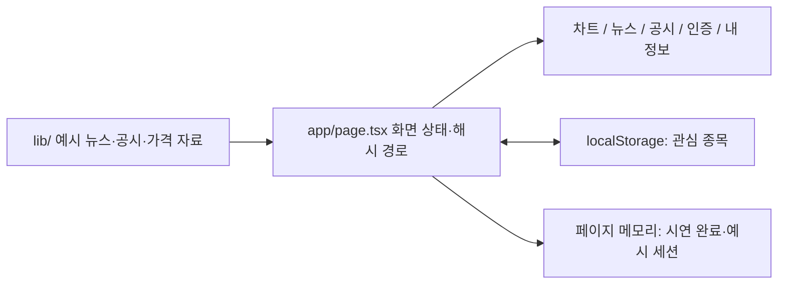
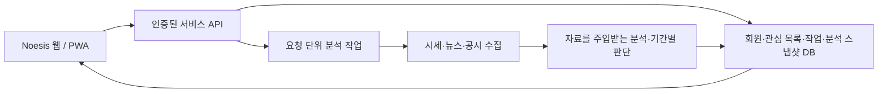

# 구조와 설계

## 현재 구현

Noesis 공개 저장소는 React·TypeScript·Vite 기반의 정적 프런트엔드다.
호스팅 계정이나 API 키 없이 실행할 수 있도록, 기존 UI 시안에서 화면과 예시 자료만 분리했다.

- `app/main.tsx`: React 진입점과 CSS 연결.
- `app/page.tsx`: 탐색·검색·관심 종목·분석 진행 시연·결과 화면.
- `components/stock-chart.tsx`: Lightweight Charts 초기화·정리, 선/캔들·거래량, 사용자 입력.
- `lib/price-history.ts`: 종목별로 같은 값을 만드는 합성 가격 이력. 거래소 휴장일을 반영한 실제 시세가 아니다.
- `components/news-banner.tsx`, `news-detail.tsx`: 배너 순환·일시정지·키보드/상세 탐색.
- `components/disclosure-panel.tsx`: 공시 일정·유형·관심 종목 필터와 상세.
- `components/auth-panel.tsx`: 실제 인증·네트워크 전송 없는 계정 흐름 시안.
- `components/profile-panel.tsx`: 예시 프로필과 이력, 화면 내 설정.

## 현재 저장 범위

| 항목 | 저장 위치 | 지속 범위 |
| --- | --- | --- |
| 관심 종목 | `noesis-ui-favorites-v1` localStorage | 같은 브라우저. 계정별 분리·기기 동기화 없음 |
| 기존 시안 관심 목록 | 새 키가 없을 때 이전 키를 읽는 호환 경로 | 같은 출처에서 이전 시안을 사용한 경우에만 해당 |
| 선택 종목·기간·시연 완료 | React 상태 | 새로고침하면 초기화 |
| 로그인·닉네임·알림 선택 | React 상태 | 실제 인증/구독 설정 아님. 새로고침 시 초기화 |
| 기본 분석 이력 | 고정 예시 | 실제 과거 분석이나 저장된 스냅샷이 아님 |

## 실제 연결 시의 설계 방향 — 미구현

프런트엔드가 증권사/모델 비밀키를 보유하지 않도록 서버에서 자료를 수집하고 작업을 실행한다.
화면 진입과 새 분석 요청을 분리하고, 작업 ID·실행 상태·입력 기준 시각을 저장한다.
기존 결과 재열람은 저장된 결과를 읽으며, 사용자별 데이터 접근은 서버에서 검증한다.

DB 제품, 인증 제공자, 작업 실행 인프라, 분석 제공 방식은 아직 확정하지 않았다.
이 다이어그램은 구현 완료 범위를 나타내지 않으며, 주문 집행 경로를 포함하지 않는다.

## 별도 프로젝트 경계

기존 자동 투자 시스템의 런타임·주문·운영 자료·Git 이력은 가져오지 않는다.
자료 부재와 관망을 구분하고, LLM 출력 자체를 검증된 투자 성과로 취급하지 않는 원칙을 유지한다.

개발자의 비공개 호스팅 미리보기와 이전 기획 원본은 로컬 `.local/`에 두고 Git에서 제외한다.
공개 제품 코드의 기준은 이 저장소다. 미리보기 복사본을 수정했다면 제품 코드와의 차이를 확인해야 한다.
